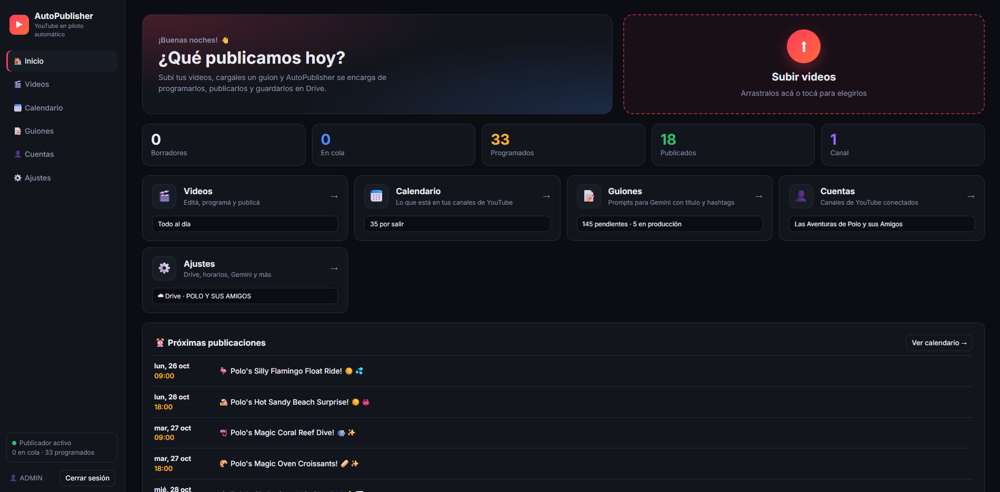

# AutoPublisher — publicación masiva y programada en YouTube



Panel web propio para preparar, programar y publicar videos (Shorts incluidos) en tus canales de YouTube.
Subís los videos, les cargás título, descripción, etiquetas y hashtags (a mano o desde un guion generado con
Gemini), elegís la fecha en el calendario y AutoPublisher se encarga de subirlos, respaldarlos en Google Drive
y liberar el espacio.

## Funciones

| Sección | Qué hace |
|---|---|
| 🏠 **Inicio** | Resumen, zona para subir videos, accesos rápidos y próximas publicaciones. |
| 🎬 **Videos** | Borradores, cola, subidas en curso, programados y publicados. Editor con título, descripción, etiquetas, traducción al inglés, playlist (y crear playlists nuevas), miniatura y calendario con horarios predefinidos. Acciones en lote. |
| 📅 **Calendario** | Lee tus canales de YouTube en tiempo real: lo publicado y lo programado, día por día. |
| 📝 **Guiones** | Fábrica de guiones con Gemini: prompt para el video + título, descripción, etiquetas y hashtags. Categorías, estados (pendiente / en producción / usado) y asignación automática al video que llega. |
| 👤 **Cuentas** | Uno o varios canales de YouTube conectados por OAuth. |
| ⚙️ **Ajustes** | Credenciales de Google, carpetas, horarios, respaldo en Drive, Gemini y cambio de contraseña. |

**Flujo de un video:** se sube desde el panel → se le asigna un guion → se programa → se sube a YouTube con la
programación nativa (`publishAt`) → se copia a Google Drive (`<carpeta>/<canal>/<playlist>/`, con una ficha `.md`)
→ 10 minutos después se borra de la Pi.

## Arquitectura

```
Navegador ──HTTPS──▶ Cloudflare (Access) ──túnel──▶ Raspberry Pi
                                                     ├─ autopublisher (Node 22, Docker)  127.0.0.1:3000
                                                     └─ autopublisher-web (nginx)        127.0.0.1:8080  ← sitio público / legales
AutoPublisher ──▶ YouTube Data API v3 · Google Drive API · Gemini API
```

```
server.js            API + servidor web
src/db.js            SQLite (data/app.db): videos, cuentas, ajustes, guiones, usuarios
src/auth.js          Login local (usuario y contraseña con scrypt, sesiones)
src/security.js      Encabezados de seguridad (CSP, HSTS…) y protección CSRF
src/watcher.js       Detecta los videos nuevos en publicar/
src/scheduler.js     Cola de subida, reintentos, cuota, respaldo en Drive y borrado
src/google.js        OAuth y YouTube Data API
src/drive.js         Respaldo en Google Drive (drive.file + Google Picker)
src/guiones.js       Biblioteca de guiones y categorías
src/translate.js     Traducción de títulos y descripciones con Gemini
agentes/             Fábrica de guiones y agentes de video con Gemini
public/              Panel (HTML/CSS/JS sin build)
sitio-publico/       Página principal, política de privacidad y términos
```

## Instalación en la Raspberry Pi (Docker)

```bash
docker compose up -d --build
```

- El panel queda en `127.0.0.1:3000` y el sitio público en `127.0.0.1:8080`; desde afuera se entra solo por el
  túnel de Cloudflare.
- La primera vez que abrís el panel te pide **crear el usuario administrador**.
- Para actualizar desde la PC: `bash deploy-pi.sh` (copia el código y reconstruye; no toca datos ni guiones).

Para desarrollo local: `npm install` y `npm start` (Node 22.13 o superior), en http://localhost:3000.

## Configuración de Google (una sola vez)

En [Google Cloud Console](https://console.cloud.google.com/), en un proyecto para AutoPublisher:

1. **APIs y servicios → Biblioteca**: habilitar **YouTube Data API v3**, **Google Drive API** y **Google Picker API**.
2. **Google Auth Platform**:
   - Pantalla de consentimiento: tipo **Externo**, links a la página principal, privacidad y términos.
   - **Acceso a los datos**: `youtube.upload`, `youtube` y `drive.file`.
   - **Público → Usuarios de prueba**: los emails de las cuentas que vas a conectar.
3. **Credenciales**:
   - **ID de cliente de OAuth** (Aplicación web) con la URI de redireccionamiento `https://<tu-dominio>/oauth2callback`.
     Se importa en **Ajustes** con el botón del archivo JSON.
   - **Clave de API** restringida a *Google Picker API* y al dominio del panel (para elegir la carpeta de Drive).
4. API key de Gemini (traducciones y guiones): https://aistudio.google.com/apikey → **Ajustes → Gemini**.

### Limitaciones de la API de YouTube
- **Auditoría:** los proyectos sin auditar suben los videos bloqueados como privados. Se pide gratis en el
  [formulario de auditoría](https://support.google.com/youtube/contact/yt_api_form).
- **Cuota:** 10.000 unidades por día. Subir un video cuesta 100, la miniatura 50 y agregarlo a una playlist 50.
  Si se agota, la cola se pausa y se reintenta sola cada hora.
- **Modo prueba:** mientras la app OAuth esté en prueba, los tokens vencen a los 7 días y hay que reconectar.

## Seguridad

- Dos barreras: **Cloudflare Access** (solo emails autorizados) y **login local** (usuario y contraseña).
- Contraseñas con scrypt y sal; bloqueo tras 5 intentos fallidos; cookies `HttpOnly` + `Secure` + `SameSite`.
- CSP, HSTS, `X-Frame-Options`, `nosniff`, `Referrer-Policy` y control de origen en todo lo que modifica datos.
- La base SQLite nunca se sirve por HTTP y queda con permisos `600`; los secretos nunca llegan al navegador.
- Contenedor sin root (uid 1000), sistema de archivos de solo lectura, sin capabilities y `no-new-privileges`.

## Fábrica de guiones

**⚙️ Plantilla** (`agentes/brief-guiones.md`) define el bloque fijo del prompt (personaje, estilo, audio) con
`{{HISTORIA}}` donde va la historia de cada video, más las reglas de la historia y de los metadatos.
**✨ Generar guiones** pide hasta 200 por tanda (de a 10 por llamada a Gemini), en la categoría que elijas y sin
repetir ideas. **📋 Copiar prompt** lo pasa a "En producción"; el video que llega después recibe ese guion, que pasa
a "Usado" recién cuando el video se sube a YouTube.

Formato `.md` de metadatos (también se puede pegar en el editor con **Cargar desde .md**):

```md
# Título
🐧 Polo and the Magic Snowflake! ❄️✨

# Descripción
Polo finds a magical, glowing snowflake...

# Etiquetas
polo the penguin, magic snow, kids cartoon

# Hashtags
#shorts #polo #youtubekids
```
